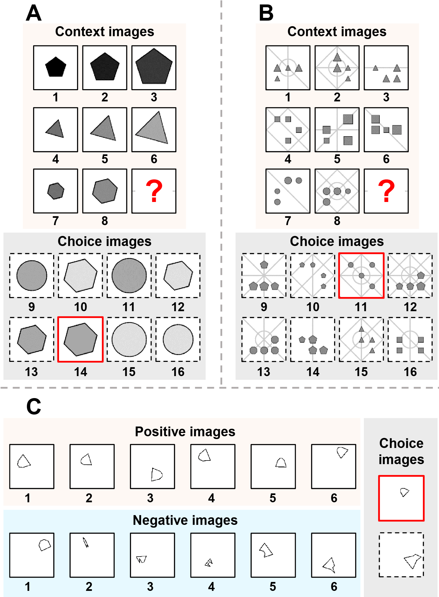
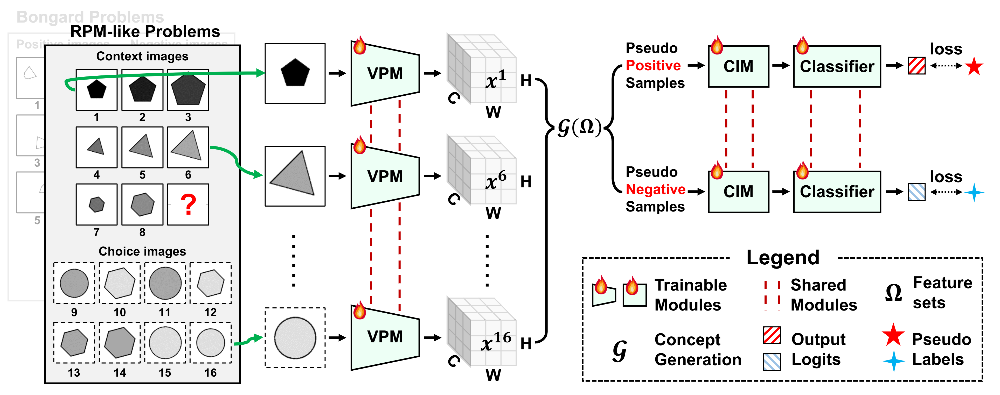
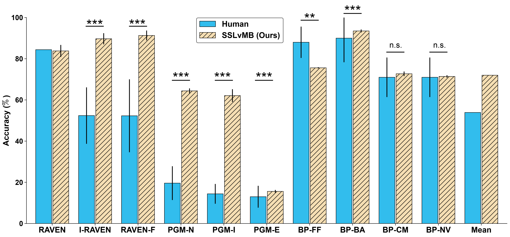

## Mental bootstrapping enables human-level concept learning in self-supervised deep models
[**Lingxiao Yang**](https://zjjconan.github.io/), [Muyang Lu](https://openreview.net/profile?id=~Muyang_Lyu1), [Ying-Jie Wang](https://ruyuanzhang.github.io/people.html), [Xiaohua Xie](http://cse.sysu.edu.cn/content/2478), [Zonglei Zhen](http://bnupsych.bnu.edu.cn/tabid/324/ArticleID/6360/frtid/307/Default.aspx), [Jian-Huang Lai](https://cse.sysu.edu.cn/teacher/LaiJianhuang) and [Ru-Yuan Zhang](https://ruyuanzhang.github.io/)

Our recent study on analogical visual reasoning (AVR), titled "Neural Prediction Errors Enable Analogical Visual Reasoning in Human Intelligence Tests" and published in **Science Advances**, provides an improved framework for self-supervised learning.

Highlights
----------
How agents acquire abstract concepts from sparse, diverse examples—often without explicit supervision—remainsa central problem in cognitive science and artificial intelligence. Human studies suggest that this ability dependson mental bootstrapping, the gradual construction of complex concepts from simpler partial structures. Buildingon this idea, we develop a self-supervised framework that trains models on systematically simplified versions ofabstract reasoning tasks containing incomplete but structured concept cues. This algorithm enables models toform internal abstractions under limited resources and later apply them to more complex problems. We evaluatethe framework across 12 abstract visual reasoning datasets testing in-distribution concept induction, out-of-distribution generalization, and few-shot learning. To contextualize performance, we also measure human accu-racy on the same tasks. Models trained on simplified problems generalize robustly, reaching or even surpassing human-level performance. These findings show that abstract reasoning can emerge from structured simplificationand minimal data, offering a computational account of concept learning in humans and machines

Two Types of Tasks
------

**RPM Task:** Example problems for this task are shown in (a) and (b). The goal is to select the correct image (highlighted in red) from eight choices to fill in the missing panel (denoted by "?"), so that the three rows or three columns exhibit similar patterns. Clearly, a subject must recognize diverse visual objects and then discover the abstract relationships among them in order to draw inferences.

**Bongard Task:** Example problem of this task is shwon in (c). Each problem presents a positive set (six images sharing a common concept) and a negative set (six images differing from that concept). The task is to classify a given image into the positive or negative set based on concepts induced from the two context sets. Bongard concepts may involve shape, color, orientation, or spatial relationships, requiring an observer to induce them from only 12 images and then classify choice images correctly.

Our SSLvMB
----------

This picture present our novel self-supervised learning method—SSLvMB. A VPM separately transforms each image to features in both RPM and Bongard problems. After that, we explicitly construct pseudo-positive and pseudo-negative samples $\mathcal{G}(\Omega)$ for model training, where each sample contains multiple image features with reduced contexts. Furthermore, a CIM is used to extract abstract concepts within each constructed sample. in CIM, two convolutional layers are used to simultaneously extract concepts along the image axis ($N$, the number of images) and spatial cues along the spatial axis ($L=$ the spatial height $H$ $\times$ width $W$).

Code environments and toolkits
-----------

- OS: Ubuntu 18.04.5
- CUDA: 11.0
- Python: 3.9.16
- Toolkit: PyTorch 1.12.1+cu102
- 4x GPU: 3090 or above
- [thop](https://github.com/Lyken17/pytorch-OpCounter)

As structures vary across different tasks, please refer to the corresponding folder. Each folder has its own README file for running (*i.e.*, [README for BDLOGO](for-RPM/README.md) and [README for RPM](for-BDLOGO/README.md)).

Results
-----------

<b>Table 1:</b> In-distribution concept induction on RAVEN, I-RAVEN, RAVEN-FAIR, and PGM-Neutral. 

 
| Datasets | Model Size | RAVEN | I-RAVEN | RAVEN-FAIR | PGM-Neutral | Avg |
|:---:     |:---:       |:---:  |:---:    |:---:       |:---:        |:---:      | 
| NCD      | 11.24 M | 37.0 | 48.2 | 56.0 | 47.6 | 47.2 | 
| PRD      | 11.18 M | 37.9 | 55.9 | 54.5 | 34.8 | 45.6 |
| SSLvMB   | 1.27 M  | **83.8 ± 2.9** | **89.7 ± 2.7** | **91.3 ± 2.4** | **64.4 ± 1.2** | **82.3** |

-----

<b>Table 2:</b> OOD concept generalization on seven PGM subdatasets.

<small>
Int: Interpolation, Ext: Extrapolation, H.O: Held-Out, P: Pairs, TP: TriplePairs, LT: LineType, SC: ShapeColor

| Method | Model Size | Int | Ext | H.O.TP | H.O.T | H.O.P | H.O.LT | H.O.SC | Avg |
|:---:   |:---: |:---: |:---: |:---:  |:---:   |:---:  |:---:   |:---:   |:---: |
| NCD | 11.24 M | 47.0 | **24.9** | 33.1 | 13.2 | 29.5 | 19.0 | **13.8** | 25.8 |
| PRD | 11.18 M | 31.5 | 12.7 | 28.1 | 18.6 | 25.2 | 14.1  | 12.8 | 20.4 |
| **SSLvMB** | 1.27 M | **62.1±3.1** | 15.6±0.7 | **43.0±0.9** | **28.6±1.7** | **32.4±2.1** | **21.7±2.1** | 12.6±0.1 | **30.9** |

**Correction Note:** In our published paper, the corresponding data for **H.O.LT** and **H.O.P** (across all methods) are inadvertently reversed and should be swapped.
</small>

-----

<b>Table 3:</b> Few-shot concept learning on Bongard-LOGO. 

<small>

| Methods | Model size | Learning type | FF | BA | CM | NV | Avg |
| :--- | :--- | :--- | :--- | :--- | :--- | :--- | :--- |
| Meta-Baseline-SC | 8.10 M | Supervised | 66.3±0.6 | 73.3±1.3 | 63.5±0.3 | 63.9±0.8 | 66.8 |
| Meta-Baseline-MoCo | 8.10 M | Supervised | 65.9±1.4 | 72.2±0.8 | 63.9±0.8 | 64.7±0.3 | 66.7 |
| ProtoNet | 8.10 M | Supervised | 64.6±0.9 | 72.4±0.8 | 62.4±1.3 | 65.4±1.2 | 66.3 |
| PredRNet | 1.27 M | Supervised | 74.6±0.3 | 75.2±0.6 | 71.1±1.5 | 68.4±0.7 | 72.3 |
| SVM-Mimic | 9.89 M | Supervised | 73.3±0.3 | 84.3±0.8 | 69.4±0.8 | **74.2±0.3** | 75.3 |
| **SSLvMB** | 1.27 M | Self-supervised | **75.6±0.3** | **93.5±0.7** | **72.7±1.1** | 71.4±0.6 | **78.3** |

</small>

-----

<b>Figure:</b> Comparisons of humans and SSLvMB. Experiments include in-distribution concept induction on RAVEN, I-RAVEN, RAVEN-F, and PGM-Neutral, OOD concept generalization on PGM-Interpolation (PGM-I) and PGM-Extrapolation (PGM-E), and few-shot concept learning on four test splits of Bongard-LOGO (BP-FF, BP-BA, BP-CM,and BP-NV). Human performance on RAVEN and all test splits of Bongard-LOGO is directly obtained from their original papers, respectively. Human performanceon all other datasets, including I-RAVEN (N=25), RAVEN-FAIR (N =25), PGM-N (N=30), PGM-I (N=30), and PGM-E (N=30) were measured in this study. the bar chart illustrates the accuracy for both human observers (blue bars) and our SSLvMB model (striped bars). the error bars of human results represent the standard deviation acrosssubjects. the error bars of model performance represent the standard deviation across three repetitions with random seeds. the significance conventions are as follows:**P < 0.01; ***P < 0.001; n.s., non-significant. See statistical details in our paper.

Citation
-----------

If you find this code useful in your research, please consider citing:
    
    @article{SSLvMB-SA26,
        author={Lingxiao Yang and Muyang Lyu and Ying-Jie Wang and Xiaohua Xie and Zonglei Zhen and Jian-Huang Lai and Ru-Yuan Zhang},
        title={Mental bootstrapping enables human-level concept learning in self-supervised deep models},
        journal={Science Advances},
        volume = {12},
        number = {35},
        pages = {eaea7202},
        year = {2026},
        doi = {10.1126/sciadv.aea7202},
        URL = {https://www.science.org/doi/abs/10.1126/sciadv.aea7202}
    }

Contact Information
-----------

If you have any suggestion or question, you can contact us by: lingxiao.yang717@gmail.com. Thanks for your attention!
